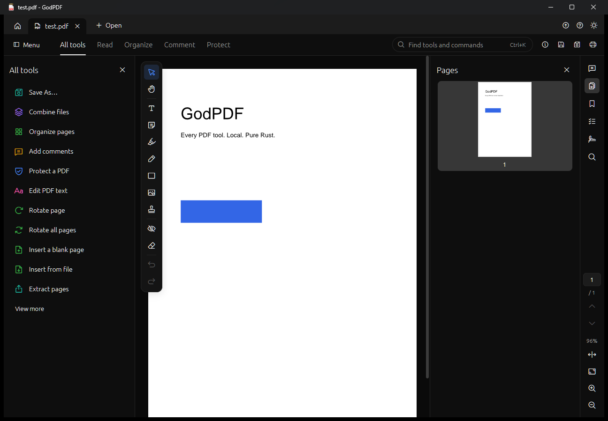

<p align="center">
  
</p>

<h1 align="center">GodPDF</h1>

<p align="center">
  <b>Every PDF tool. Local. Pure Rust.</b><br>
  View, edit, sign, organize and protect PDF files on your own machine.
</p>

<p align="center">
  <a href="https://github.com/0XLUC4/GodPDF/releases/latest"></a>
  
  
</p>

<p align="center"></p>

No account, cloud storage or telemetry. Documents stay on your computer unless you choose to share them.

## Download

| Platform | File |
|----------|------|
| Windows | `GodPDF-windows-x64.exe` |
| Linux | `GodPDF-linux-x64.tar.gz` |
| macOS | `GodPDF-macos-universal.zip` |

Get them from the [latest release](https://github.com/0XLUC4/GodPDF/releases/latest).
The Windows build is a single file with nothing to install. It is not signed, so SmartScreen may ask before the first run.
New versions arrive through the Updates button, which downloads the update and restarts the app.

## Features

**Read**
- Tabs, continuous scroll, zoom, fit width or page, dark and light themes
- Recent files on the home screen with a preview of their first page
- Find as in a browser (`Ctrl+F`): every match highlighted, jump from word to word
- Thumbnails, bookmarks and comments panels, two documents side by side
- Large plans (A3 to A0) stay sharp at any zoom

**Comment and mark up**
- Highlight, underline and strike out by selecting the text
- Text boxes with fonts, bold, italic, underline, subscript and superscript, and a handle to change their width
- Sticky notes, ink, rectangles, ellipses, lines and arrows, with a fill colour for shapes
- Stamps: Approved, Draft, Confidential, Rejected, Final, with an optional date
- Preset colours plus a picker with hex input and recent colours
- Move, resize, bring to front or send to back, all in real time
- Eraser for whole comments or for the page content itself

**Edit**
- Select and copy text with the pointer
- Change the text of a page line by line
- Put pictures on a page, move and resize them
- Sign with a signature drawn once and kept
- Fill in forms on the page, add text fields and check boxes
- Redact: remove text, pictures and comments under the marked areas for good

**Organize**
- Page grid: reorder by drag and drop, rotate, delete, insert blank pages or other files, extract, split, reverse, remove blank pages
- Combine PDFs, pictures and text files, interleave two scans
- Crop, change page size, cut pages in half, 2 to 16 pages per sheet, booklets, join into one long page
- Invert, greyscale or tint the paper

**Protect and share**
- Open encrypted files, add or remove a password, remove hidden data
- Sign with a certificate (`.pfx`, `.p12`) and check the signatures of a PDF
- Page numbers and watermarks
- Compress, export pages as PNG or JPEG, print
- Recognize the text of scans (OCR), compare two PDFs
- Attached files, document properties, undo and redo

The command palette (`Ctrl+K`) finds every tool by name.

## Share a PDF

Open a PDF and click **Share**: a popup shows a 6-digit code. Give it to one person you trust. On the GodPDF home screen they click **Join** and type the code. The session displays the other computer's name.

You start with editing control. The other person sees changes as you make them. Choose **Pass editing control** to let them edit and follow their changes instead. Use **End session** to disconnect. Each person can save their current copy locally.

The connection is encrypted. GodPDF connects directly when possible and can use an encrypted relay on different networks. Shared PDFs must be unencrypted at the file level and at most 64 MiB. The host and guest must keep GodPDF running during the session.

## Certificate signatures

**Sign with certificate…** (`Ctrl+K`) signs with the key of a `.pfx` or `.p12` file (RSA or ECDSA P-256, SHA-256). GodPDF asks for the file's password and an optional reason and location. It then writes a signed copy to a new file: a detached CMS signature (`adbe.pkcs7.detached`) added as an incremental update, so earlier signatures remain valid. The password is used only to read the key and is not stored.

When a signed PDF opens, GodPDF checks its signatures. **Signatures…** lists each one with the signer, the signing time and the result:

- **Valid**: the document has not changed since it was signed.
- **Modified after signing**: the signed revision is intact, but content was appended after it.
- **Invalid**: the signed bytes changed, or the signature does not match its certificate.

Limits: the signature is invisible. Place a drawn signature first if the page should show one. GodPDF does not validate certificate chains against a trusted authority, check revocation or add timestamps, so self-signed certificates are accepted. Any edit made in GodPDF rewrites the whole file and invalidates its signatures, so sign last. Encrypted documents cannot be signed or checked.

## Build

Requires Rust 1.95 or newer.

```sh
cargo run --release -p godpdf
```

Linux needs the GPUI system libraries:

```sh
sudo apt-get install pkg-config libxkbcommon-dev libxkbcommon-x11-dev libwayland-dev \
  libvulkan-dev libx11-dev libx11-xcb-dev libxcb1-dev libfontconfig1-dev libfreetype6-dev
```

macOS needs Xcode, which GPUI uses to compile its Metal shaders.

## Workspace

| Crate | Role |
|-------|------|
| `crates/core` (`godpdf-core`) | PDF editing on raw bytes with `lopdf`, undo and redo |
| `crates/render` (`godpdf-render`) | Page rendering with `hayro` |
| `crates/app` (`godpdf`) | Desktop app built with [GPUI](https://gpui.rs) |
| `crates/thumbs` (`godpdf-thumbs`) | Windows Explorer thumbnails of PDF files (shell extension DLL, embedded in the app) |

## License

Licensed under either of MIT or Apache-2.0, at your option.
