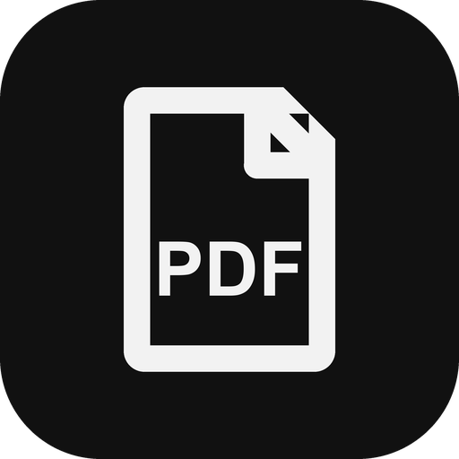
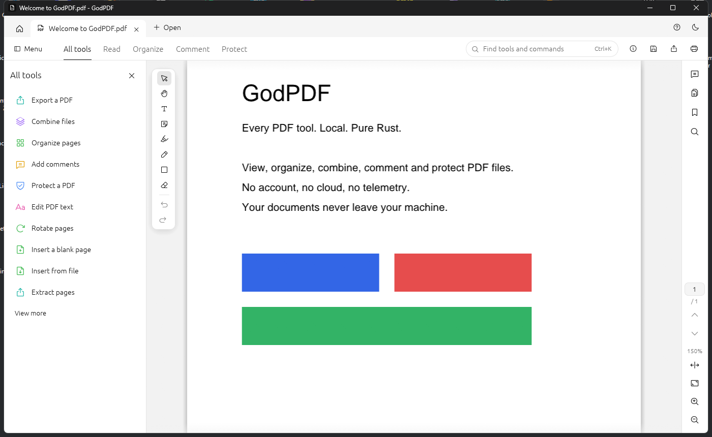

<p align="center"></p>

<h1 align="center">GodPDF</h1>
<p align="center">Every PDF tool. Local. Pure Rust.</p>

<p align="center"></p>

A PDF workbench.
No account, no cloud, no telemetry: your documents never leave your machine.

## Download

Windows: get `GodPDF-windows-x64.exe` from the [latest release](https://github.com/0XLUC4/GodPDF/releases/latest).
It is a single file, nothing to install. It is not signed, so Windows SmartScreen may ask before running it.

## Features

- View: tabs, continuous scroll, zoom, thumbnails, bookmarks, search, dark/light theme
- Organize: drag-and-drop reorder, rotate, delete, insert blank or from file, extract, split
- Combine: merge any number of PDFs
- Comment: highlight, sticky note, free text, rectangle, ink
- Protect: open encrypted PDFs, add or remove a password
- Document properties, text extraction, undo/redo history, command palette (`Ctrl+K`)

## Build

Requires Rust 1.94+.

```sh
cargo run --release -p godpdf
```

## Workspace

| Crate | Role |
|-------|------|
| `crates/core` (`godpdf-core`) | Editing ops on PDF bytes via `lopdf`, undo/redo session |
| `crates/render` (`godpdf-render`) | Page rasterization via `hayro` |
| `crates/app` (`godpdf`) | `egui`/`eframe` desktop app |

See [docs/PLAN.md](docs/PLAN.md) for the roadmap.

## License

MIT OR Apache-2.0
